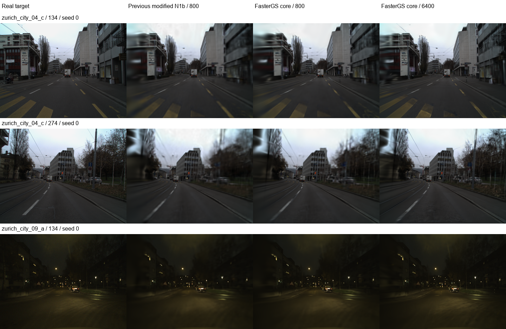

# 原 FasterGS4D 核心配置补测

**等训练渲染次数下，原 FasterGS4D 核心配置比当前修改版高约 1.42 dB，9/9 次运行均更高。** 原始单时刻训练、原 FusedAdam 和 L1+DSSIM 损失值得保留；此前的 N1b 曝光积分实验尚未显示相对这一基线的优势。

必须先说明执行范围：完整 `FasterGS4DTrainer` 导入时，Windows 应用控制阻止 `MortonEncoding._C`，报错为 `An Application Control policy has blocked this file`。没有更改系统策略或替代被阻止的扩展。本次完成的是**原始渲染、优化器和损失的固定容量适配对照**，并非完整原版 30,000 步、增密/剪枝训练流程复现。

## 实际使用的原始实现

- 原 FasterGS4D CUDA rasterizer，每张训练图只在其真实曝光中点渲染一次。
- 原生 `FasterGS4DCudaBackend.torch_bindings.adam.FusedAdam`，epsilon `1e-15`，原始参数组与默认学习率。
- 直接加载未修改的 `src/Methods/FasterGS4D/Loss.py`，使用 `.8 * L1 + .2 * (1 - fused_ssim)`；已核验损失及其梯度。
- 参数默认值从原 `Trainer.py` 读取。空间/时间均值初始学习率为 `.00016 * camera_extent`，SH0 `.0025`、SH-rest `.000125`、opacity `.05`、空间/时间尺度 `.005`、时空旋转 `.001`。只有空间位置使用原指数衰减。
- 本数据相机 extent 为 `0.28010586`，未衰减的位置/时间中心率为 `4.48169e-5`。沿用共同初始化已训练 1,200 步这一计数，空间学习率从第 1,201 步继续衰减。

数据、标定、分辨率、留出时间点和 seeds 0/1/2 完全沿用上一轮 DSEC 三片段；每次加载对应旧运行的同一个 `shared_initial.pt`，记录文件 SHA256。模型仍为 32,768 高斯、SH3，无额外 warmup。为固定容量，排除增密、剪枝、opacity reset、Morton 排序及 SH 递增；这些也是与完整默认流程的实质差别。详见 [固定协议](FASTERGS_CORE_PROTOCOL.md)。

## 两种预算都报告

N1b/Gauss8 每步渲染八次，原 FasterGS 每步一次。因此原核心配置在同一训练轨迹保存 **800 步**与 **6,400 步**两个预先固定的模型，训练全部结束后才评估，未按测试集选取模型。

| 方法 | 更新步数 | 训练渲染数 | PSNR ↑ | SSIM ↑ | LPIPS-VGG ↓ |
|---|---:|---:|---:|---:|---:|
| 原 n1b-v2 设置（上一轮适配） | 800 | 6,400 | 30.40676 | 0.847094 | 0.409541 |
| 修改版 n1b-v2 | 800 | 6,400 | 30.46102 | 0.850399 | 0.401512 |
| Gauss＋修改优化器 | 800 | 6,400 | 30.46190 | 0.850407 | 0.401511 |
| 原 FasterGS 核心，等更新步数 | 800 | 800 | 30.13402 | 0.859901 | 0.355969 |
| **原 FasterGS 核心，等渲染次数** | **6,400** | **6,400** | **31.88184** | **0.888693** | **0.256187** |
| 单时刻＋修改优化器/MSE 控制 | 800 | 800 | 30.45697 | 0.850397 | 0.401423 |

FasterGS 表中使用原单时刻推理，上一轮方法使用其统一曝光积分推理。为检查观测模型差别，也对 FasterGS 同一模型做共同 Gauss32 曝光评估：800 步为 **30.13080 dB**，6,400 步为 **31.88280 dB**，与原推理近乎相同，结论不依赖这一选择。

三片段分别对三个种子平均：

| 片段 | 修改版 N1b，800 步 | 原 FasterGS 核心，800 步 | 原 FasterGS 核心，6,400 步 |
|---|---:|---:|---:|
| 日景 120–143 | 28.41615 | 27.89175 | 29.71658 |
| 日景 260–283 | 25.14996 | 24.63016 | 25.83837 |
| 夜景 120–143 | 37.81694 | 37.88014 | 40.09057 |

等渲染次数下，原核心相对修改版平均 **+1.42082 dB**，单次范围 **+0.61910～+2.36473 dB**，9/9 次均提高。固定区域平均 PSNR 为 **35.09314 dB**，修改版为 **32.86650 dB**；ROI 是既定矩形，不是精确运动分割。

## 这些结果说明什么

1. **等步数并不等渲染预算。** 原核心 800 步只用八分之一训练渲染数，PSNR 略低，但 SSIM/LPIPS 更好。L1+DSSIM 与 MSE 具有不同取舍，不能仅凭 PSNR 宣称所有指标都更差。
2. **这些片段不需要每步八次曝光渲染才能达到上一轮精度。** 严格保留修改版的优化器、MSE、所有外观/运动学习率，仅将 Gauss8 改为单时刻 Gauss1，PSNR 为 30.45697 dB，与修改版 30.46102 dB 相差约 0.004 dB；LPIPS 基本相同。短曝光或平滑时间响应使多节点积分收益很小。
3. **更多参数更新和原始重建损失比当前积分改造更有效。** 6,400 次渲染用于 6,400 次原核心更新时，细节与感知指标明显改善。这是整个原核心配置的结果，尚未分别消融损失、参数学习率及更新次数的贡献。
4. **这不是等时长或速度结论。** 800/6,400 步原核心平均增量训练耗时约 0.97/7.31 秒，上一轮修改版约 4.68 秒。相同渲染数不代表相同 FLOPs、优化开销或墙钟时间；桌面 GPU 也未隔离。所有条件共同初始化成本相同，未重复计入。

本轮独立 Gauss32-vs64 平均图像 MSE 最大为 `2.72e-9`，曝光评估已足够收敛。DSEC 没有本片段对应的瞬时清晰 RGB 真值，本结果仍只证明留出有限曝光帧重建，不能证明真实去模糊收益。

## 结果与复现

固定每个片段 seed 0 的第四个留出时刻、左相机作图，无效果筛选：

- [指标与模型审计](results/fastergs_core/audit.json)：两种预算及单时刻控制、双重推理、LPIPS、积分收敛和模型 SHA256。
- `results/fastergs_core/fastergs_core_*.json`：9 份原始运行记录，原代码/共同初始化指纹、学习率和训练预算。
- `output/fastergs_core_c120_s*`、`output/fastergs_core_c260_s*`、`output/fastergs_core_n120_s*`：800/6,400 步模型、控制模型、预测图。
- [测试适配代码](real_fastergs.py)、[审计脚本](real_fastergs_audit.py)、[原损失与时间点检查](test_real_fastergs.py)。原生产源码未修改。

新检查核验了原始加权损失及梯度、单次渲染的真实曝光中点、原学习率仅衰减空间均值。完整数据与既有修正的回归测试一并保留。完整原版 Trainer 仍受上述系统扩展加载限制，不能将本报告引用为它已成功运行的结果。
