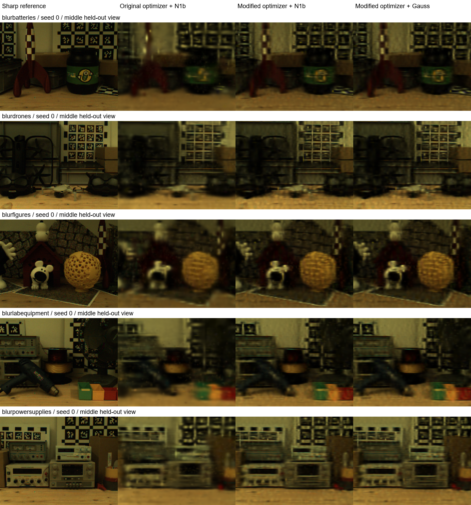

# 真实曝光数据上的 N1b-v2 验证

**结论：优化修正在真实清晰测试图上带来了收益，但没有发现 N1b 分区积分相对公平 Gauss 对照的实际收益。** 本次完成全部 5 个真实场景、3 个随机种子、45 组方法训练；不是仅下载数据或合成模糊测试。

## 数据已下载并核验

使用作者公开的 [Ev-DeblurNeRF-CDAVIS](https://github.com/uzh-rpg/EvDeblurNeRF)。[原论文](https://rpg.ifi.uzh.ch/docs/CVPR24_Cannici.pdf)说明采用 Color-DAVIS346、100 ms 曝光、滑轨编码器轨迹和另外拍摄的静止清晰图像。

- 本地：`E:\4D_Gaussian\dataset\evdeblurnerf_real\ev-deblurnerf_cdavis`。
- 下载的是真实 CDAVIS 包，**不是 Blender 合成数据**；压缩包 195,638,862 字节，完整解压全部五个场景。
- SHA256：`1117dd16caef0cc4e05db830119edf00860177bc7415f6778cc2bfb65e7c200a`。
- 实际读取各帧元数据，训练曝光为 **99.998–100.000 ms**；使用逐帧起止值，不从帧率推断。
- 保留官方末尾五张清晰图作为测试，每个场景 346×260；训练图分别为 18、11、15、17、18 张。
- 测试图中的零时间戳/零区间是标记，不代表真实零秒快门。静态场景的测试时刻按其相机滑轨位置对应到轨迹时间，映射完整保存在运行记录。

## 公平性与适配范围

每次运行使用 8,192 个高斯，仅从模糊训练图初始化，先共同训练 1,200 步，保存相同初始模型，再分别细化 600 步。三组使用相同数据、训练视图顺序、8 次渲染/步、模型容量及外观参数更新，不使用事件、EDI 图、清晰测试监督或外部预训练模型。

“原始”指保留原 N1b-v2 的分区规则与原始 XYZ/log-time Adam 步长；“修改版”使用此前的条件协方差坐标归一化及时间步长修正；**Gauss 也使用同一个修正后的优化器**。三者均加入相同的真实相机运动与外观学习适配。因此这是原方法的真实数据适配对照，不能称为直接运行未修改的八高斯合成脚本，也不是原作者论文榜单复现。

曝光内相机随记录轨迹移动，不能固定为帧中心相机。轨迹边缘使用线性外推，最长 9.969 ms，逐场景记录。记录曝光起止不等于知道快门响应曲线：区间内矩形权重及在给定 RGB 域积分仍是共同模型假设。完整协议见 [REAL_CDAVIS_PROTOCOL.md](REAL_CDAVIS_PROTOCOL.md)。

## 清晰测试结果

以下对五场景、三种子等权平均，每次对五张测试图平均。共 25 个独立测试视图，各重复三次初始化；不能当作 75 个独立场景样本。PSNR/SSIM 在 float RGB 上计算，LPIPS 为 VGG，数值越低越好。

| 方法 | PSNR ↑ | SSIM ↑ | LPIPS-VGG ↓ |
|---|---:|---:|---:|
| 共同初始化 | 26.53794 | 0.733134 | 0.486145 |
| 原 N1b-v2 优化设置，统一真实数据适配 | 25.27904 | 0.699589 | 0.528283 |
| 修改版 N1b-v2 | **27.31987** | **0.768222** | **0.446480** |
| Gauss + 相同修改优化器 | 27.31939 | 0.768196 | 0.446486 |

修改版相对原设置平均 **+2.04083 dB**，单次范围 +1.07011～+2.76677 dB，15/15 次均提升。相对共同初始化平均 **+0.78193 dB**，范围 +0.69056～+0.92722 dB，同样 15/15 次提升。说明收益确实体现在真实清晰测试图上，而不只是模糊训练图拟合。

修改版相对匹配优化器的 Gauss 平均仅 **+0.000482 dB**，范围 −0.000890～+0.002060 dB；LPIPS 差值约 0.000006。不能把这种量级解释为方法优势。

逐场景 PSNR（三种子平均）：

| 场景 | 共同初始化 | 原设置 | 修改版 | Gauss |
|---|---:|---:|---:|---:|
| batteries | 26.44080 | 25.04632 | 27.20198 | 27.20102 |
| drones | 26.41545 | 25.84812 | 27.21140 | 27.21089 |
| figures | 27.58614 | 26.42020 | 28.29843 | 28.29798 |
| lab equipment | 26.82072 | 25.02153 | 27.55152 | 27.55140 |
| power supplies | 25.42660 | 24.05901 | 26.33602 | 26.33565 |

## 对原因的进一步验证

1. **原始位置更新尺度过大。** 相对共同初始化，原设置的高斯平均位置位移为 0.18290 个数据集世界单位；修改版为 0.004167，约小 44 倍，同时清晰指标更好。这里是参数位移，数据没有真实几何，因此不称为几何误差降低 44 倍。
2. **分区规则多数时候并未产生新的采样方案。** 修改版 81.46% 的步骤与全局 Gauss 节点完全相同；大多数时间支撑覆盖整个曝光窗，或触发原有全局回退。剩余步骤也没有带来可观的测试收益。
3. **积分误差不是当前主要瓶颈。** 所有组的 Gauss8-vs16 图像 MSE 相对训练重建 MSE 最大仅 0.0426%；独立复核中，16-vs32 平均图像 MSE 最大为 9.71e-9。继续提高时间积分精度不足以解释约 2 dB 的优化修正收益。
4. 同等步数下，细化平均耗时原设置 4.50 s、修改版 4.64 s、Gauss 4.22 s。桌面存在其他 GPU 占用且未做隔离计时，**这些只是运行记录，不作为速度结论**。没有等时长优势声明。

在这种真实静态场景、约 100 ms 曝光和有限容量实验中，应保留优化尺度修正；不能继续把“分区积分优于 Gauss”作为已经成立的结论。

## 可视化与可复现文件

下面固定选每个场景 seed 0 的中间测试视图，未按效果挑选。细节仍明显低于清晰参考，说明本次小规模固定容量、短程细化不是最终重建质量上限。



- [原始逐运行结果与复核汇总](results/real_cdavis/audit.json)：LPIPS、积分收敛、参数位移、模型 SHA256、各运行绝对路径。
- `results/real_cdavis/*_s*.json`：15 份原始指标、逐帧曝光、划分、数据文件哈希、脚本哈希、训练时间。
- `output/real_cdavis_*/`：共同初始化、三方法最终模型、预测图。batteries/seed 0 的目录名为 `real_cdavis_batteries_s0`；其余名称含完整场景名。
- [下载脚本](download_cdavis.py)、[训练适配](real_cdavis.py)、[独立审计](real_cdavis_audit.py)、[采样等价测试](test_real_cdavis.py)。

PowerShell 复现命令见协议。全部 15 个运行结束后：

```powershell
$env:PATH = 'E:\4D_Gaussian\.conda\nerficg\Library\bin;' + $env:PATH
$env:TORCH_HOME = 'E:\4D_Gaussian\.cache\torch'
& .conda/nerficg/python.exe -m experiments.n1b_v2.real_cdavis_audit
& .conda/nerficg/python.exe -m unittest experiments.n1b_v2.test_partition experiments.n1b_v2.test_joint_optimization experiments.n1b_v2.test_exposure experiments.n1b_v2.test_real_cdavis
```

验证通过：15 项单元测试；加速采样适配与原分区实现在随机支撑/旋转下相同；所有 15 个训练配置使用同一个脚本哈希。没有改动生产渲染器、CUDA 后端或旧 coffee_martini 结果。

**适用边界：这是静态场景相机运动模糊的图像重建验证，不是动态 coffee_martini 的验证；没有动态物体、真实深度或 3D 几何真值，也没有证明分区方法的额外收益。**
