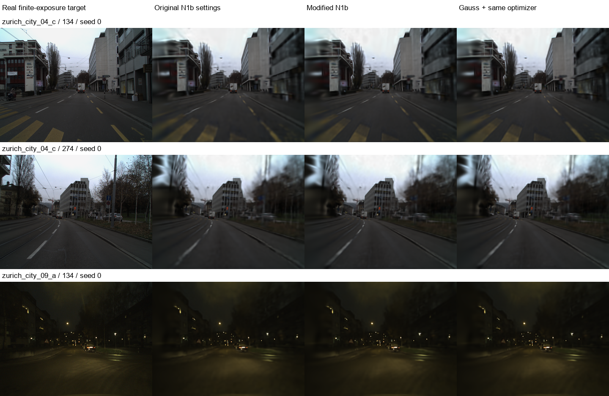

# 真实曝光、标定动态场景验证

**本次没有验证到修改版相对公平 Gauss 的额外重建收益。** 优化修正在夜景和固定物体区域有小幅改善，但全图 PSNR 的收益随片段变化，不能沿用静态实验中“稳定提升约 2 dB”的结论。

## 数据已下载，满足曝光与标定要求

选择真实 [DSEC RGB 双目街景](https://github.com/uzh-rpg/DSEC)。[官方格式说明](https://dsec.ifi.uzh.ch/data-format/)提供左右相机逐帧曝光起止时间（微秒）、已校正 RGB 图及相机标定；[论文](https://rpg.ifi.uzh.ch/docs/RAL21_DSEC.pdf)说明使用硬件触发的全局快门相机。

本地数据：`E:\4D_Gaussian\dataset\dsec_dynamic`。下载原作者 ZIP 中的实际 PNG 成员，核对 ZIP CRC32 并记录 SHA256，保留曝光表、统一时间戳、相机内外参。用于实验的三个片段共 72 个时刻、144 张原始双目图；另保留少量选片预览图。

| 序列与帧范围 | 内容 | 实测曝光范围 |
|---|---|---:|
| zurich_city_04_c，120–143 | 日景，经过的电车与前方车辆 | 0.968–1.181 ms |
| zurich_city_04_c，260–283 | 日景，驶近路口的交通 | 0.871–1.069 ms |
| zurich_city_09_a，120–143 | 夜间街景与车辆，较长曝光压力测试 | 14.996 ms |

曝光直接来自文件中的 start/end，未用帧率替代。时间先以 float64 减去局部原点，再换算秒和归一化坐标。

也调查并下载了 HDR-GoPro 的训练图和标定样本。其论文给出绝对快门设置，但本次未充分核验公开提取帧的物理时间间隔、裁剪与标定对应关系，因此没有给它假定帧率后混入结果。Fraunhofer 动态模糊数据需要邮件申请访问，本次没有发送邮件。候选筛选与详细复现条件见 [固定协议](REAL_DYNAMIC_PROTOCOL.md)。

## 对照如何保持公平

每片段 24 个时刻，固定留出第 2、6、10、14、18、22 个时刻的左右两图作为测试；其余 18 对训练。**测试是新时间点，不是整台未见相机。** 相机外参使用真实双目标定，以随相机运动的 rig 坐标为统一坐标系，4D 模型同时表达自车引起的相对运动与独立物体运动，不虚构世界相机轨迹。

分辨率 360×270，内参同步缩放。32,768 个高斯，仅从训练双目图计算 SGBM 深度初始化，先共同 warmup 1,200 步，再分支细化 800 步。所有分支使用相同初始化、观测顺序、8 次全图原生渲染/步、外观与运动参数更新，均训练空间位置、时间宽度、时间中心和左右时空旋转。没有固定为静态模型，也没有使用测试深度或清晰图初始化。

- **原设置**：原 N1b-v2 分区规则、原始 XYZ/log-time Adam 学习率。
- **修改版**：相同分区，使用此前的条件协方差坐标归一化及时间步长修正。
- **Gauss**：全局 Gauss8，使用与修改版完全相同的改进优化器。

这三者是统一的真实动态数据适配，包含相同的外观和运动学习，并非直接运行未改动的八高斯合成脚本。主要公平条件为等步数、等渲染次数；未等化墙钟时间。先做冒烟和一个日景 pilot，随后保持设置不变，完成 3 片段 × seeds 0/1/2，共 27 组方法训练。

## 留出动态帧重建结果

所有最终模型统一使用 **Gauss32** 在目标图自身的真实曝光窗口内积分；PSNR/SSIM 使用 float RGB，LPIPS 使用 VGG。下表为每片段三个种子的平均 PSNR。

| 片段 | 共同初始化 | 原 n1b-v2 设置 | 修改版 | Gauss＋相同优化器 | 修改版－原设置 |
|---|---:|---:|---:|---:|---:|
| 日景 120–143 | 26.3617 | 28.4389 | 28.4161 | 28.4164 | −0.0228 dB |
| 日景 260–283 | 23.9756 | 25.3101 | 25.1500 | 25.1518 | −0.1602 dB |
| 夜景 120–143 | 34.9570 | 37.4712 | 37.8169 | 37.8175 | +0.3457 dB |

所有片段、种子等权平均：

| 方法 | PSNR ↑ | SSIM ↑ | LPIPS-VGG ↓ | 固定区域 PSNR ↑ |
|---|---:|---:|---:|---:|
| 共同初始化 | 28.43142 | 0.808385 | 0.458473 | 30.42624 |
| 原 n1b-v2 设置 | 30.40676 | 0.847094 | 0.409541 | 32.62712 |
| 修改版 | 30.46102 | 0.850399 | 0.401512 | 32.86650 |
| Gauss＋相同优化器 | 30.46190 | 0.850407 | 0.401511 | 32.86831 |

修改版相对共同初始化 +2.02960 dB，9/9 次提高；但原设置和 Gauss 继续训练也有收益，不能把这一数值全部归因于修正。修改版相对原设置平均仅 +0.05425 dB，范围 −0.21000～+0.40599 dB，仅 4/9 次全图 PSNR 更高。

修改版相对 Gauss 平均 **−0.000882 dB**，范围 −0.003225～+0.000672 dB；SSIM/LPIPS 同样基本相同，没有额外优势。

固定区域由预先声明的中央车辆区域与左前景矩形组成，不是真实运动分割 mask。修改版相对原设置的区域 PSNR 在三个片段分别 +0.1173、+0.2618、+0.3391 dB；LPIPS 也小幅改善。这说明外观/局部误差与全图 PSNR 的取舍不同，不能描述为所有动态区域都改善，夜景高 PSNR 也受大片暗背景影响。

## 为什么动态实验仍没有采样收益

**真实规模的时间支撑边界触发了原有全局回退。** 三组全部 800 步中，N1b 返回的采样节点与全局 Gauss 相同。对最终模型独立检查 324 个“模型 × 测试曝光”组合，回退前有效区间数为 **16–1,038**；order 8 预算只允许最多 4 个区间，因此 **100% 回退**。即使按 order 32 的阈值审查，99.07% 的组合仍会回退；这里只统计回退条件，没有伪称已经训练了 order 32 对照。

这解释了修改版与 Gauss 的近乎一致：两者具有相同优化器，并实际执行相同积分规则。残余千分之一 dB 量级差异与原生 CUDA 梯度浮点累加的不确定性一致，不能视为分区收益。

此外，Gauss16-vs32 测试图平均 MSE 的最大值为 **1.37e-9**；独立 Gauss32-vs64 检查最大为 **4.53e-10**。积分已经收敛，提高采样精度难以解决当前可见的几何/外观模糊。修改版平均参数位置位移 0.06555，原设置 0.15527 个 rig 坐标单位；这里没有几何真值，因此仅称参数位移，不能称为真实几何误差降低。

时空旋转和运动参数确实参与训练；修改版各运行高斯参数速度中位数约 0.065–0.118 rig 单位/秒。该数值混合自车相对运动，不能解释为物体在世界坐标中的真实速度。

因此，之前的优化修正可以改善部分指标，但**不足以形成稳定的动态重建方法优势**。当前结构性问题是全场景支撑分区在实际高斯数量下过细，随后又整体退回 Gauss；继续只微调位置学习率无法让这条采样路径体现优势。

## 结果文件与验证

固定选择每个片段 seed 0 的第四个留出时刻、左相机作图；未按效果挑选。

- [独立指标审计](results/real_dynamic/audit.json)：LPIPS、Gauss32/64 收敛、参数运动、模型哈希、软件环境。
- [分区回退审计](results/real_dynamic/support_audit.json)：324 个曝光的区间数量与回退判定。
- `results/real_dynamic/zurich*_s*.json`：9 份原始运行结果、逐图指标、真实曝光、标定与训练记录。
- `output/dsec_c120_s*`、`output/dsec_c260_s*`、`output/dsec_n120_s*`：共同初始化、最终模型、预测图。
- [下载器](download_dsec.py)、[动态适配与训练](real_dynamic.py)、[指标审计](real_dynamic_audit.py)、[支撑审计](real_dynamic_support_audit.py)、[数据与标定测试](test_real_dynamic.py)。

18 项测试通过，包括时间单位往返、双目极线/基线几何、修改测试像素不影响训练初始化、加速分区与原实现等价、此前修正的回归检查。9 次完整运行使用同一训练脚本 SHA256。

夜景 seed 2 首次进程启动在创建输出目录之前以 Windows `0xC0000005` 退出，保持相同参数重跑后完整成功；没有挑选模型或替换种子。失败信息保存在验证记录，空启动日志与重跑日志均保留。

**适用边界：本次已验证真实动态场景的留出有限曝光帧重建；DSEC 这些片段没有配对的瞬时清晰 RGB 真值，因此尚不能证明去模糊或瞬时清晰重建收益。只有三个短片段，其中两个来自同一序列，也不代表完整规模训练的质量上限。**
