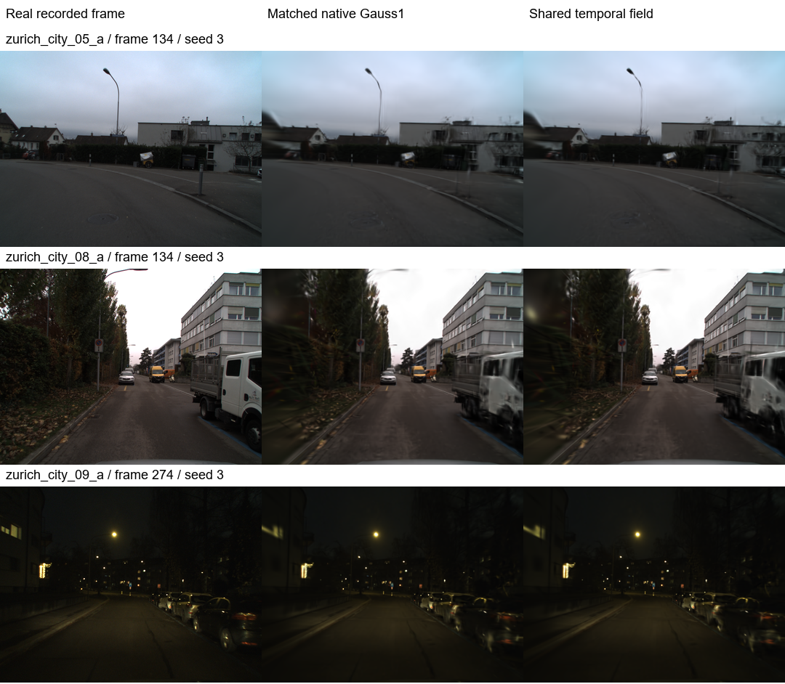

# N1b 后续结构：真实数据确认结果

2026-10-26。**找到一个在本轮固定容量真实数据协议下稳定提高重建质量的结构：
八时间节点共享的仿射轨迹校正。** 冻结后的三片段、三个新种子共九对模型，在
相同6,400次更新/渲染下，PSNR全部提升，平均 **+0.29588 dB**；SSIM与LPIPS也
分别在9/9对模型上改善。预先写下的确认判据全部通过。

有效改动位于**时间表示层**，积分仍使用普通Gauss。原N1b解析控制变量、v2分区
积分及本轮预算内分区，均没有获得这项真实重建收益；不能将成功归因到它们。

## 结构与控制

原生4D高斯的条件中心为 `mu_i + v_i * (t - tau_i)`。新结构增加共享校正：

```
x_i(t) = mu_i + v_i * (t - tau_i) + A(t) @ mu_i + b(t)
```

`[A(t), b(t)]`由归一化时间[0,1]上的八个均匀节点线性插值。每个节点为3×4矩阵，
总共新增 **96个参数**，相对32,768高斯的2,129,920个原生参数增加约0.0045%。
初值为零，初始渲染与对照相同，额外参数学习率固定3e-5。

它为所有高斯提供共享的分段时间变化，同时保留各高斯原生运动。这里改变的是
中心轨迹，不把协方差作仿射推送，也不声称恢复了物理相机位姿或真实世界速度。

所有臂使用原FasterGS的FusedAdam、原始L1+DSSIM损失、相同原生参数学习率及
空间学习率衰减。主对照与候选都以Gauss1在真实曝光中点训练，统一用Gauss32曝光
积分评估。共同初始化、训练观测顺序、32,768个高斯、SH3、背景和数据完全一致。
所有原生参数均可训练，没有增密/剪枝、额外图像监督或测试集驱动的停止。

生产Trainer没有改动。本轮使用既有原生CUDA渲染器的固定容量适配；之前阻止
MortonEncoding扩展加载的系统安全策略未更改。

## 冻结后的新片段确认

候选在开发阶段选定后，先保存协议与源码哈希，再运行以下预留数据：

- `zurich_city_05_a`，120–143：此前未用的序列。
- `zurich_city_08_a`，120–143：此前未用的序列。
- `zurich_city_09_a`，260–283：已用夜景序列的新窗口。
- 每片段seeds 3/4/5；每臂只用训练双目观测初始化，并共同warmup 1,200步。
- 360×270，每片段24个时刻，留出局部索引2、6、10、14、18、22的左右相机图像。

这是三片段、九个初始化配对。三片段共有36个不同的留出“相机×时间”观测，
每个观测重复三个种子；不把108次评估当作108个独立场景。曝光和标定来自
[DSEC官方数据](https://dsec.ifi.uzh.ch/dsec-datasets/download/)，未以帧率替代曝光。

相同6,400次更新和渲染，以下按每片段三个种子平均：

| 片段 | 普通Gauss PSNR | 新结构 PSNR | PSNR增益 | SSIM变化 | LPIPS变化↓ |
|---|---:|---:|---:|---:|---:|
| city_05_a / 120 | 31.09537 | 31.60624 | **+0.51087** | +0.004444 | −0.010517 |
| city_08_a / 120 | 26.03024 | 26.25732 | **+0.22708** | +0.005734 | −0.009503 |
| city_09_a / 260 | 34.03418 | 34.18388 | **+0.14970** | +0.000929 | −0.003217 |
| **等权平均** | | | **+0.29588** | **+0.003702** | **−0.007745** |

逐种子PSNR增益范围 **+0.09520～+0.68813 dB**，9/9为正。固定矩形区域PSNR
平均提高0.51585 dB；这些区域沿用既定矩形，不是真实运动分割。

**最低增益案例的数值重复需要保留：** 夜景seed4在主确认中为+0.09520 dB，
随后保持相同初始化、配置、观测顺序，交换两臂运行次序做两次重复，得到
**+0.02824 / +0.01129 dB**。两次仍为正，但幅度明显缩小，说明最弱案例的
小幅优势对运行数值差异敏感，不能把+0.09520当作精确可复现幅度。重复没有
替换原确认结果，也没有用于改候选；原始记录为`repeat_min_n260_s4_1/2`。
因此“稳定”限于多片段/种子的整体收益，不保证每次运行都有明显涨幅。

候选同更新数耗时平均10.52秒，对照7.57秒，约增加39%。这项质量收益不能直接
写成速度收益；因此另做了实际等时间比较。

## 等时间结果与明确保留的退化

每臂独立从共同初始化开始，12秒训练额度，每步后CUDA同步。模型构建、共同
初始化、保存和评估一致地排除。最后一个完整更新有微小超额，实测总时间为
12.00004–12.00158秒；全部实际步数和耗时均保留，没有按每秒误差外推。

| 片段 | 平均PSNR增益 | 平均SSIM变化 | 平均LPIPS变化↓ |
|---|---:|---:|---:|
| city_05_a / 120 | +0.36150 | +0.003619 | −0.000516 |
| city_08_a / 120 | +0.11951 | +0.005319 | +0.000854 |
| city_09_a / 260 | +0.07966 | +0.000520 | +0.005828 |
| **等权平均** | **+0.18689** | **+0.003153** | **+0.002056** |

PSNR为8/9对提高，范围−0.04805～+0.48567 dB；夜景seed4的−0.04805 dB是
真实保留的失败。LPIPS只有4/9对改善，平均略差。因此不能宣称同时间下全部指标
占优。普通Gauss完成8,141–10,370步，候选完成6,118–7,651步；这也体现了当前
Python/Torch结构的额外开销。桌面图形仍活动，计时结论限于本机这组实际预算实验。

## 更强积分对照与长训练

预先额外声明了两个检查，没有用其结果选择候选：

1. **普通Gauss8也训练6,400步**，即使用51,200次原生渲染，是候选的八倍。
   在三个预留片段的seed3，候选相对Gauss8的PSNR仍分别高
   **0.43464、0.26016、0.04879 dB**。这只覆盖三个指定配对，未冒充九组全部复核。
2. **开发日景/夜景延长到30,000步**，每臂同样的更新/渲染次数且只评最终模型：

| 开发片段 | 普通Gauss | 新结构 | 增益 | LPIPS：普通→新结构 |
|---|---:|---:|---:|---:|
| city_04_c / 120 / seed0 | 30.34132 | 31.07035 | **+0.72903 dB** | 0.20564→0.19018 |
| city_09_a / 120 / seed0 | 40.54005 | 41.09980 | **+0.55975 dB** | 0.21405→0.20675 |

这支持收益能持续到更长训练，但它仍是开发片段、固定容量的检查，不是完整默认
增密Trainer或新的独立数据确认。同更新数下候选仍有额外耗时。

## 失败路径、归因和核验

- 新预算内分区减少了固定模型的积分/梯度误差，但真实训练相对Gauss8仅约
  −0.00056 / −0.00309 dB，且更慢，没有实际涨点。
- 时间中心解耦收益不一致；时间扭曲及单一曲率的收益较小。共享场的过大学习率
  1e-3明显退化，失败模型与指标全部保留。
- 双节点线性场在开发对照中明显弱于八节点结构，支持额外分段时间自由度的作用。
  目前没有完整分离表示能力、共享约束和优化条件的所有贡献，也不主张新颖性。
- 10项最终检查通过：初值/保存渲染等价、路径解耦、时间扭曲单调性、新参数梯度、
  曝光单位/双目标定/初始化不读取测试像素，以及原损失、梯度和学习率语义。
- 36个主确认模型的独立哈希均匹配。Gauss32/64平均图像MSE的最大值为
  `7.35e-10`，远小于重建误差；这是加密收敛证据，不是严格误差上界。
- 确认前冻结的源码哈希始终匹配。所有方法完整训练后才评估，不选最佳检查点。
  [完整失败与开发记录](RESEARCH_LOG.md)和原始JSON保留。

## 文件与可复现入口

- [确认协议](CONFIRMATION01_PROTOCOL.md)、[源码冻结哈希](confirmation01_frozen.json)。
- [逐对指标与判据](results/confirmation01_assessment.json)、[独立审计](results/confirmation01_audit.json)。
- [强Gauss8审计](results/gauss8_audit.json)、[长训练审计](results/long01_audit.json)。
- [核心结构](models.py)、[新目录复现命令](README.md)。
- 模型与逐次训练记录：`E:\4D_Gaussian\output\n1b_v3\`。

固定选取各预留片段seed3的第四个留出时刻、左相机，未按效果挑选：



**结论边界：** 已支持上述DSEC有限曝光帧重建协议中的稳定质量提升；尚未验证
百万高斯、完整增密训练、coffee_martini主基线、未知标定、瞬时清晰图恢复或任意
场景上的普遍优势。确认的是可复现的时间表示候选，而非原N1b积分路线的成功。
