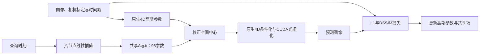

# 导师阶段汇报稿：基于 FasterGS4D 的共享时间轨迹校正

核对日期：2026 年 10 月 27 日。建议汇报 8–10 分钟，按下面七页组织 PPT。正文可直接口述，表格可直接放入幻灯片。

**核心结论：** 当前候选是在原生 4D 高斯上增加八个时间节点共享的仿射中心校正，共 96 个参数。固定容量 DSEC 实验的九组确认均有质量提升；完整原生训练尚未显示稳定优势。最新 coffee_martini 配对中 PSNR 下降，SSIM、LPIPS 小幅改善，未通过预设迁移门槛。

## 第 1 页｜研究问题与当前进展（约 45 秒）

老师好，今天我主要汇报动态高斯重建的算法结构和阶段实验结果。

目前我以 FasterGS4D 为基线，研究的问题是：能否在保留原生高效渲染框架的前提下，用很少的额外参数，改善高斯随时间变化的轨迹表示。

当前已经找到一个有实验支持的候选：给所有高斯增加一个共享的、随时间分段变化的仿射中心校正。它在固定高斯数量的真实数据实验中表现比较一致，但迁移到包含增密和剪枝的完整训练后，收益还不稳定。因此，这次汇报的重点是结构验证及其适用边界。

## 第 2 页｜基线如何表示动态场景（约 1 分钟）

FasterGS4D 使用原生四维高斯联合表示空间和时间。每个高斯包含空间中心、时间中心、空间及时间尺度、四维旋转、透明度，以及球谐颜色系数。

给定一个时刻，四维高斯可以条件化成三维高斯，再投影到相机平面，通过高斯光栅化和透明度混合生成图像。

与本次改动最相关的是中心轨迹。单个四维高斯的条件中心可以写为：

\[
\mathbf{x}_i^{\mathrm{base}}(t)=\boldsymbol\mu_i+\mathbf v_i(t-\tau_i),
\qquad \mathbf v_i=\Sigma_{i,xt}/\Sigma_{i,tt}.
\]

这里的速度由四维协方差推导得到。对单个高斯来说，这条条件中心轨迹关于时间是线性的；多个高斯及其时间权重仍然可以共同表达更复杂的动态。

因此，我尝试给原生轨迹补充一组共享的时间变化自由度，使多个高斯能够协同调整。

## 第 3 页｜当前算法结构与训练方式（约 1 分 30 秒）

新结构在原生条件中心上增加一项：

\[
\mathbf{x}_i(t)=\boldsymbol\mu_i+\mathbf v_i(t-\tau_i)
+\mathbf A(t)\boldsymbol\mu_i+\mathbf b(t).
\]

其中，A 是三乘三矩阵，b 是三维平移向量。二者由归一化时间零到一上的八个均匀节点线性插值得到。每个节点有十二个参数，总共增加九十六个参数。代码中名称为 affine_spline，但具体实现是分段线性插值。

直观地说，每个高斯仍保留自己的原生运动，同时所有高斯共享一个随时间变化、随空间中心线性变化的校正场。这个校正可以提供分段的轨迹变化，但还不能把它解释成真实相机运动或者真实物体速度。

在固定容量实验中，原生参数约为二百一十三万，增加九十六个参数只占约百分之零点零零四五。新参数从零初始化，学习率固定为三乘十的负五次方。

训练损失沿用基线：

\[
\mathcal L=0.8\mathcal L_1+0.2(1-\mathrm{SSIM}).
\]

实现上只在送入原生 CUDA 渲染器前校正空间中心。协方差没有做仿射推送，所以它是中心轨迹校正，并非对整个高斯形状作完整的仿射形变。完整 Trainer 适配中，新增参数用独立的原生 FusedAdam 更新，原生的增密、剪枝等流程继续执行。

**可直接放入 PPT 的流程图：**

## 第 4 页｜指标和实验口径（约 1 分钟）

质量主要看三个指标：PSNR 衡量像素重建误差，越高越好；SSIM 衡量局部结构相似性，越高越好；LPIPS 使用 VGG 特征衡量感知差异，越低越好。成本同时记录训练耗时、最终高斯数量和额外参数量。

这里需要区分两套实验。第一套是固定容量验证，用三万二千七百六十八个高斯，主要隔离时间表示本身的作用。第二套是完整原生训练，保留增密、剪枝、透明度重置、球谐升阶和 Morton 排序，检查结构能否迁移到实际训练流程。

固定容量主实验在曝光中点训练，两种结构最终统一用三十二点 Gauss 曝光积分评估。完整原生实验的主指标则使用单时刻推理、八位图像量化后的逐图均值。因此，两套实验应分别比较各自的基线与候选，不能直接比较它们的绝对 PSNR。

| 指标 | 方向 | 汇报时的含义 |
|---|---|---|
| PSNR / dB | ↑ | 像素误差；图像值归一化到 [0,1] 时为 −10 log10(MSE) |
| SSIM | ↑ | 局部结构相似程度 |
| LPIPS-VGG | ↓ | 基于 VGG 特征的感知差异 |
| 实测训练时间 | ↓ | 参数少不代表计算开销小 |
| 最终高斯数 | 结合质量解释 | 完整增密训练下，两臂容量可能不同 |

## 第 5 页｜固定容量实验：质量提升有较一致证据（约 1 分 30 秒）

固定容量的独立确认覆盖 DSEC 三个真实片段，每个片段三个新种子，共九组配对。候选在确认前已经冻结，所有方法使用相同初始化、数据顺序和六千四百次更新，每次更新渲染一次。

| DSEC 片段／起始帧 | 基线 PSNR | 新结构 PSNR | ΔPSNR / dB | ΔSSIM | ΔLPIPS ↓ |
|---|---:|---:|---:|---:|---:|
| city_05_a／120 | 31.09537 | 31.60624 | +0.51087 | +0.004444 | −0.010517 |
| city_08_a／120 | 26.03024 | 26.25732 | +0.22708 | +0.005734 | −0.009503 |
| city_09_a／260 | 34.03418 | 34.18388 | +0.14970 | +0.000929 | −0.003217 |
| 三片段等权平均增量 | — | — | **+0.29588** | **+0.003702** | **−0.007745** |

三个质量指标在九组主确认中全部改善，平均 PSNR 提高约零点三 dB。这支持共享时间轨迹结构在当前固定容量协议下有作用。

不过，计算开销也增加了。同更新数下，候选平均耗时十点五二秒，基线七点五七秒，增加约百分之三十九。改成同样十二秒预算后，平均 PSNR 仍提高零点一八七 dB，但只有九组中的八组提高，LPIPS 平均反而变差零点零零二零六。因此目前不能声称速度提升，或者同时间下所有指标都更好。

最弱案例的重复实验增益也明显缩小到零点零一至零点零三 dB，说明小幅收益对数值差异比较敏感。

**配图建议：** 使用现成的 [固定视图对照图](../experiments/n1b_v3/results/confirmation01_comparison.png)，展示目标、基线和候选。这些视图按预设规则选取。

## 第 6 页｜完整原生训练：迁移收益尚不稳定（约 1 分 30 秒）

接下来我把同一个冻结结构接入完整 FasterGS4D Trainer，每臂从原生初始化开始训练三万步，保留原生密度控制。

DSEC 目前完成 city_05_a 的两个种子配对：一个种子 PSNR 下降零点零一八 dB，另一个提高零点五零三 dB。结果一胜一负，还不足以支持稳定性结论，原计划的九组配对也尚未全部完成。

| 完整原生 DSEC 对照 | 原生 PSNR | 新结构 PSNR | ΔPSNR | ΔSSIM | ΔLPIPS ↓ |
|---|---:|---:|---:|---:|---:|
| city_05_a／seed 3 | 24.45803 | 24.43996 | −0.01807 | −0.020846 | +0.013902 |
| city_05_a／seed 4 | 24.14172 | 24.64465 | +0.50292 | +0.020223 | −0.015094 |

今天最新完成了 coffee_martini 的完整配对。它使用原生多相机加载器，全分辨率一千三百五十二乘一千零一十四，五千一百张训练图像、三百张测试图像，每臂训练三万步，batch size 为四。

| coffee_martini／seed 0 | 原生基线 | 新结构 | 候选−基线 |
|---|---:|---:|---:|
| PSNR ↑ | 26.594776 | 26.519172 | **−0.075604 dB** |
| SSIM ↑ | 0.895719 | 0.896429 | +0.000709 |
| LPIPS-VGG ↓ | 0.213642 | 0.212908 | −0.000734 |
| 运行计时，含设置与清理／秒 | 2144.86 | 2213.73 | 约 +3.21% |
| 最终高斯数 | 1,927,085 | 1,954,214 | +27,129 |

这一组结果是混合的：结构和感知指标略有改善，但像素误差指标下降，耗时和最终高斯数也增加了。按照事先设定的“PSNR 提升且 SSIM、LPIPS 不退化”的迁移门槛，这一组没有通过。

我已经核对两臂初始化哈希一致，最终检查点哈希匹配，均完成三万次训练回调、一百四十四次增密和四次训练阶段 Morton 排序。但它仍然只是一个场景、一个种子，不能据此推断所有场景都会失败。

## 第 7 页｜当前判断和下一步（约 1 分钟）

我现在的判断分为两个层次。

第一，八节点共享仿射中心校正在固定容量真实数据实验中有比较一致的质量收益，值得继续分析。第二，这个收益还没有稳定迁移到完整原生训练，最新 coffee 结果也没有通过预设门槛，所以现阶段不宜把它表述成已经优于 FasterGS4D 的完整方法。

接下来我准备优先分析固定容量与完整训练之间的差异，重点看共享场和原生运动参数是否互相补偿，以及校正场如何影响增密后的高斯分布和优化过程。这些目前都是待验证解释。

完整 DSEC 队列在后续种子启动时出现进程异常，剩余配对还需要先恢复实验环境，再按冻结协议补齐。coffee 的本轮迁移门槛失败，因此不会把当前结果当成通过后继续扩展种子的依据。

如果后续需要修改结构或学习率，我会将其作为新的开发阶段，重新安排独立确认。希望这次和老师重点讨论：共享时间结构是否值得继续做，以及应该优先解决表示本身的问题，还是它与增密优化的耦合问题。

## 导师可能追问的问题

**1．目前的贡献到底是什么？**

目前可以明确的是：实现并验证了一个九十六参数的共享时间轨迹候选，在限定的固定容量协议中有一致改善。其相对已有工作的研究新颖性尚未确立，完整训练的优势也尚未确立。

**2．这和之前 N1b 的曝光积分路线是什么关系？**

前期探索过解析控制变量和分区积分。那些方法有些能降低固定模型的积分或梯度误差，但没有获得本次真实重建收益。当前收益来自时间表示层的改动，曝光评估仍使用普通 Gauss 求积。

**3．是不是加入了一个形变网络？**

当前没有使用 MLP。它是八个三乘四矩阵的时间插值，对所有高斯共享；每个时刻提供一个全局仿射形式的中心校正。它对多个独立物体的不同非刚性运动，表达能力可能受限，这一点仍需验证。

**4．为什么参数很少，速度却变慢？**

参数量只有九十六，但每次渲染都要对全部高斯计算校正，同时增加梯度传播。当前还有 Python／Torch 实现的开销，因此参数开销与运行开销需要分开衡量。

**5．为什么固定容量有效，完整训练不稳定？**

目前没有完成因果归因。两套协议在初始化、容量变化、训练时长及评估方式等方面存在差异。原生增密可能改变共享场的作用，原生参数也可能吸收部分校正能力；这些是需要通过控制实验区分的假设。

**6．是在做去模糊吗？用到了 DSEC 事件吗？**

当前证据支持有限曝光 RGB 帧的重建，没有清晰瞬时真值来证明真实去模糊效果。现有这套实验使用 DSEC 双目图像、标定和曝光信息，没有引入事件流监督。

**7．coffee 的历史基线不是 26.3211 吗？**

26.3211 是十月十八日归档的旧部署结果。此次配对中新跑的原生基线为 26.5948，候选为 26.5192，判断本次改动应使用这组配对。新旧运行之间存在数值和实验运行差异，不能拿候选超过旧基线来声称改进有效。

**8．结果可信度如何保证？**

固定容量确认前冻结候选、协议和源码哈希，使用预留片段及新种子，保留失败与重复结果，并做独立指标和积分收敛核验。完整原生配对记录初始化、检查点和训练回调；增密会影响后续随机数消耗，因此相同种子不等于全程逐步采样顺序相同。

## 核对依据与数据边界

- 算法实现：[v3 模型](../experiments/n1b_v3/models.py)、[完整 Trainer 适配](../experiments/n1b_native/native.py)。
- 固定容量结果：[结果说明](../experiments/n1b_v3/RESULTS.md)、[逐对确认 JSON](../experiments/n1b_v3/results/confirmation01_assessment.json)。三片段共 36 个不同的留出相机×时间观测，重复三个种子，不能说成 108 个独立场景。
- 原生 DSEC 已完成配对：[assessment.json](../experiments/n1b_native/results/assessment.json)。当前只有两个配对。
- 最新 coffee 原始结果：[原生](../output/n1b_native/native03_coffee_s0_native/results.json)、[候选](../output/n1b_native/native03_coffee_s0_field/results.json)。本稿重新读取两份 JSON 并计算增量；两份 final.pt 的 SHA256 均与各自记录匹配，均有 300 条测试观测。
- 完整训练主指标口径：[评估代码](../experiments/n1b_native/run.py)，单时刻推理、双方图像八位量化、逐图计算后平均、LPIPS-VGG。
- 迁移判据：[预设门槛](../experiments/n1b_native/TRANSFER_GATE.md)。coffee seed 0 因 PSNR 下降未通过。
- 队列状态：[completion_error.json](../output/n1b_native/completion_error.json)。后续 DSEC 启动异常是实验未完成的原因，不作为算法质量失败计入统计。
- 既有原生 RESULTS.md 和 assessment.json 的快照早于 coffee 完成；其中“coffee 尚待完成”的描述已过时。本稿以最新原始运行记录为准，未改写已有实验记录。
- DSEC 使用自定义相机支架坐标适配，属于本项目实验协议，不是官方 DSEC 基准成绩。未验证全场景泛化、真实相机运动恢复、真实去模糊或最先进性能。
