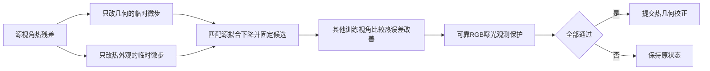

# CTG-GS：跨视图检验的热红外几何监督（设计稿 v1）

2026-10-29。状态：算法提案与可测试参考模块；**未训练、未获得重建指标、未完成原生 Trainer 接入**。

## 1. 研究目标和结论边界

在已有 FasterGS4D / N1b v4 上，用训练阶段的热红外观测改善低照度、运动模糊条件下的 RGB 新视角重建。推理时只需模型、RGB 相机和时间，不需输入热图。先做有标定的静态多视角低光场景，再扩展动态曝光积分。热图不能凭空恢复完全缺失的可见光颜色，也不天然等同于深度、轮廓或真实温度。

拟验证的具体假说：**在源视角拟合改善相当时，如果热红外驱动的几何微调比“只修改热外观”的反事实更能改善其他视角，且不损害可靠 RGB 的曝光观测，那么该微调更可能有助于 RGB 重建。** 这是选择监督的经验假说，不是物理几何可识别性的定理。

共享几何、双外观头、曝光积分和反事实更新选择均有先例。候选的新意仅在“源拟合匹配 + 跨视角热证据 + 曝光一致 RGB 保护”这一具体监督规则及其可证伪评估。不能宣称首次热辅助 GS、首次动态 RGB-T 或首次反事实几何/外观优化。最近邻和风险见 [LITERATURE.md](LITERATURE.md)。

## 2. 表示与两传感器成像

沿用原生四维高斯参数 \(\theta\) 及独立 RGB SH 外观 \(c\)。增加每个高斯一个低容量热辐射参数 \(h_i\)。静态版本取常数；动态版本至少增加一阶时间项，并以分段时间热外观作为更强对照，避免把温度变化硬塞进几何。

\[
\mu_i(t)=\mu_i^{base}(t)+d_i^T
\quad[+\ \sigma_{xyz,i}^{ref}a_i q_i(t)^2\ \text{仅在动态扩展中}],
\qquad q_i(t)=\operatorname{clip}((t-\tau_i)/\sigma_{t,i}^{ref},-3,3).
\]

\(d_i^T\) 是热监督的独立校正缓冲区，初始为零，由接受规则更新；不直接覆盖原生 Adam 参数。动态加速度来自已有 N1b v4，不能归为本方法的新贡献。主消融首先只允许热监督修改中心，不修改协方差、透明度、时间支撑或 RGB SH。

对传感器 \(m\in\{V,T\}\)，在其真实相机射线和原生分辨率下：

\[
\widehat Y^m_v=F_m\!\left(e^m_v\sum_{k=1}^{K_m}w^m_{vk}\,
\mathcal R_m(\theta(t^m_{vk}),P^m(t^m_{vk}),c/h)\right),\quad
w_k\ge0,\ \sum_k w_k=1.
\]

- RGB 积分在黑电平校正后的线性域完成，再施加固定相机响应。初版用线性化/去马赛克 RAW；去马赛克相关噪声意味着简单方差模型只是近似。不对 sRGB 直接求曝光平均并声称物理正确。
- IR 用独立 \(K_T,P_T\)、畸变预校正、实际曝光核；不能把低分辨率 IR 放大后当 RGB 像素真值。热相机自身也会模糊、有噪声/滞后。已知 PSF/响应在外部固定建模；未知严重滞后、rolling shutter 或非线性 AGC 暂不纳入主实验。
- 若只有热图强度，\(h\) 只代表可渲染热外观，不解释为 Kelvin。可用固定/离线估计的每帧正增益和偏置吸收全局漂移，锚定参考帧以消除尺度自由度；每次反事实比较中这些参数完全冻结。局部 AGC 不能用全局仿射自动解决。
- 必须分别满足两相机标定、同步和重叠可见性。固定单应配准只能近似解决平面/远景，不能证明同像素是同一条三维射线。

固定的观测损失为噪声标准化鲁棒误差：

\[
\ell_m=\frac{\sum_p w_m(p)[\sqrt{1+((\widehat Y_m-Y_m)/s_m(p))^2}-1]}{\sum_p w_m(p)}.
\]

\(s_m>0\) 为标定/离线估计噪声，\(w_m\) 标记有效、非饱和且可见区域。普通 RGB 优化保留全部有效区域；RGB **保护检查**使用固定可靠区域。遮罩、噪声、热仿射校正全部 stop-gradient，禁止随候选重新选择以掩盖错误。DSSIM 可作为普通 RGB 训练辅助项，但所有组必须一致；不能把 RGB 与 IR 的亮度或梯度逐像素强行拉齐。

## 3. 核心：源拟合匹配的跨视图热监督

### 3.1 初始阶段

从统一初始化运行相同 RGB + 曝光模型的基线前缀，完成密度发展；随后固定拓扑并拟合热外观头，热损失此时不改几何。初版在后半程插入热校正事务，密度控制保持关闭。所有比较组使用相同初始化、prefix、传感器模型和可见性遮罩。

这个设计只能修正**已有覆盖**，不能长出先前漏掉的夜间物体。低光 SfM 或初始化已经失败时，先解决标定/初始几何，且所有对照共享该辅助信息；不能只给候选白天图、清晰点云或真值位姿。后续热辅助增密是另一项研究，不混入当前贡献。

### 3.2 两种不提交的解释

在热源视角 \(s\) 上，以同一个冻结状态构造：

\[
H_G: (d^T+\Delta d,h),\qquad H_A:(d^T,h+\Delta h).
\]

G 仅改变已有中心校正；A 仅改变热外观，RGB 头两者均冻结。动态 A 至少含低阶时间热项，另设更强 A 消融。用一次源视角反传获得两组一阶梯度，沿参考尺度归一化的 SGD 方向试探有限步；不共享 RGB Adam 动量，不使用 Hessian/JVP。

对 G、A 都只在源视角作有界步长搜索，最多各 4 个预定尺度。统一限制源观测变化的噪声标准化 RMS 和每点位移。先在源视角选定 G 的有效微步，再选择与其源损失下降匹配的 A：

\[
g_s^G=\ell_T^s(0)-\ell_T^s(H_G)>\epsilon_s,\quad
g_s^A>\epsilon_s,\quad
|g_s^G-g_s^A|\le \rho\max(g_s^G,g_s^A).
\]

默认原型 \(\rho=0.2\) 只是待开发值。两种假设自由度不同，匹配拟合下降不能证明模型复杂度相同；但比单纯相同学习率或参数范数更有可比性。A 若无法匹配，结果标为“归因不确定”，**拒绝几何提交**，不能把弱反事实的失败算作几何证据。A 不接触 witness 进行选步。

### 3.3 热证据与 RGB 保护

固定候选后，在不同于源视角的至少一个、优选两个有重叠的训练视角 \(W\) 上，分别计算 G/A 的热误差下降。动态场景必须优先同一物理时刻的不同视角；不能把热场在变化的邻帧当独立证人。

\[
\forall v\in W:\quad g_v^G>\epsilon_T,\qquad g_v^G-g_v^A>\eta_T.
\]

再要求 G 在可靠 RGB 观测上的损失不增加超过预设容差：

\[
\ell^{v, reliable}_V(H_G)\le\ell^{v, reliable}_V(0)+\epsilon_V,
\quad
\ell^{v, reliable}_V(H_G)\le\ell^{v, reliable}_{V,anchor}+\epsilon_{V,total}.
\]

第二个约束使用固定事务窗口前的锚点，防止每次少量容忍累积成较大退步。窗口切换不得以擦除既有伤害为目的；另保留固定 audit bank、累计位移上限和总体损失审计。暗到没有可靠 RGB 支撑时，初版拒绝热几何事务；它不声称可以还原完全不可见的颜色。

全部通过才把 G 写入热校正缓冲区。拒绝时真实模型和所有优化器状态保持不变；A 从不提交。RGB 常规训练与热外观训练分别按既定节奏继续。这个模块可以减少错误热监督，但不会保证每次真实几何或测试指标都改善。

Witness 也是训练观测，只是不参与**当次** proposal 梯度及候选搜索；不能称为统计意义的 cross-fitting 或独立测试。源/witness 角色按固定种子轮换，不用正式验证/测试图控制任何更新。

## 4. 现有代码的真实可行性

| 位置 | 可复用能力 | 必须新增/避免的事情 |
|---|---|---|
| `src/Methods/FasterGS4D/Renderer.py` | 给定相机/时间渲染、独立 SH 输入 | RGB 和 IR 分别调用；IR 标量重复到3通道并取 mean；不要借用 RGB SH |
| `.../torch_bindings/rasterization.py` | 对高斯参数的一阶梯度 | settings 返回 None，timestamp 是 float，且 `once_differentiable`；不能直接学位姿/曝光/时间偏移或求二阶导 |
| `src/Datasets/utils.py::View` | 相机与时间戳 | 外部 PairedObservation 增加曝光核、传感器、真实 K/外参、有效域、split、同步证据；native View 本身无这些字段 |
| `experiments/n1b_v4/model.py` | 中心残差、参考尺度、剪枝排序处理 | 新热头/残差/置信度/额外优化器也必须跟随 prune、sort 和最终 cleanup；不能只改 render |
| `src/Methods/FasterGS4D/Trainer.py` | RGB step、密度控制与 callback 顺序 | 自定义事务 hook 必须在 optimizer step 完成、梯度清空后；热事务不给 densification_info 写统计 |

原生只返回 RGB，没有直接 depth/alpha 输出。本提案不假设免费可微深度或逐像素 Gaussian ID。初版用固定标定、保守重叠 ROI、有效域与场景玻璃/反射剔除。需要精确遮挡判断的区域必须增加并验证深度/可见性实现，不能凭空构造 mask。

参数接入原则：用独立 `thermal_delta` 缓冲区保存已接受校正，普通 RGB graph 对原生参数求导；热 G graph 冻结原生参数，仅以 `thermal_delta` 临时 leaf 求导；热 A graph 冻结几何，仅让 IR 头求导。试探中禁用增密、排序、随机背景和优化器 step。渲染候选使用函数式 tensor override，不能直接修改 `.data` 再试图不完整恢复。

校正需限制每步及累计投影位移；候选参考尺度从共同 prefix 固定。若仍允许原生 shape/time 参数继续 RGB 优化，参考尺度和 checkpoint 状态必须分开存储，且阶段性 audit 防止与热残差互相补偿。动态热加速度不在当前代码原型中实现。

## 5. 成本与计划中的实验节奏

热检查每 16 次 RGB 更新一次（开发候选，不是已验证最优设置）；热图使用真实低分辨率。一个事务至少包含源视角反传、G/A 源试探、G/A witness 前向、G 的 RGB 保护前向。RGB 曝光 K=4 时每个 guard 就需要4次光栅化；不能因为只新增少量参数就声称低开销。

用 M 个 witness、J 个 RGB guard、每路线至多 B 次源试探估算额外前向上界：`(1 + 2B + 3M) * K_T + 2J * K_V`，另有源反传；未计正常热头拟合。缓存只在参数/遮罩/曝光完全相同时有效。初版 K_V 取4，离线用8/16点检验积分收敛；不能把求积误差当算法增益。

容量：N 个高斯，静态热头 N 个参数，热中心残差 3N 个 float 缓冲；N=200万时两者约32 MB，不含热头 Adam、试探副本、render graph。热头单独 Adam 若额外存梯度+两矩约再24 MB；峰值显存须实测。推理省去热头，仅保留最终几何校正；任何 PLY 导出必须正确烘焙常量中心校正，动态项需要原生扩展格式。

## 6. 预期收益、反例与停止条件

最有希望：RGB 弱纹理/中度曝光运动模糊，但 thermal 有对比度、标定可靠、已有几何覆盖。预期先改善边界稳定和几何，RGB PSNR 可能只小幅改善，不能承诺 dB。

高风险：热反射/玻璃、低热对比度、移动热斑、热响应滞后、热头欠拟合、错位、透明度跨谱差异、漏结构、全暗颜色不可识别。**静止平面上的移动热斑**可能让多视角 G 同时下降而被错认成几何；必须专门做负对照，并给 A 增强时间表达。更强 A 若消除优势，应接受“此前只是外观欠拟合”的结论。

全局 gate 可能被局部反射阻断，或全局均值隐藏小区域退步。初版保守拒绝，并记录区域误差、拒绝原因、热几何接受率；不未经验证改成每点 gate。若有效覆盖充分时接受率仍<5%，或在温度变化负对照中错误接受明显，则暂停扩展并重新设计。超过普通加权热损失、PCGrad 或最近反事实路由适配之前，不把组合包装成独立方法优势。

完整数据/消融协议见 [EVALUATION_zh.md](EVALUATION_zh.md)。

## 7. 本轮交付范围

- 已实现的参考模块：曝光平均、噪声损失、IR SH0打包、梯度隔离、函数式有界提议、源拟合匹配与跨视图接受判定。
- 单元测试只检查这些算子与接受条件；不证明重建质量、新颖性、GPU可用性或原生Trainer可运行。
- 尚未实现：真实双模态加载器、相机/曝光标定、源候选搜索器、真实光栅化适配、完整事务提交/持久化、同步可见性、热外观训练、数据集评估。
- 未修改 FasterGS4D submodule；没有开始训练。reviewer 的独立结论另存 [REVIEW.md](REVIEW.md)。
